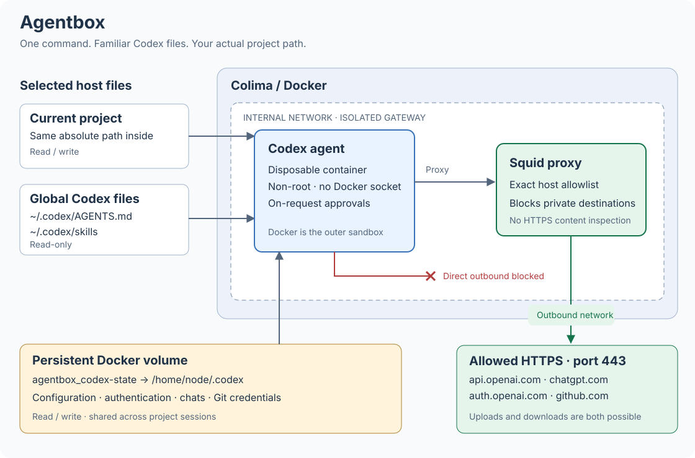

# Agentbox

Run Codex in Docker, sharing your project and selected global instructions and
skills, with outbound traffic restricted to an explicit allowlist.

```sh
cd /path/to/project
agentbox
```

- **Fast to launch:** one command reuses built images and starts Colima if needed.
- **Familiar configuration:** edit the usual `.codex` files. Settings, login, and
  chats persist between disposable containers.
- **Recognizable projects:** your working directory appears at the same absolute
  path inside Codex, keeping project context and history filtering meaningful.
- **Limited host access:** only selected files are mounted; a separate proxy
  controls outbound destinations.



## Setup — macOS

Requires [Homebrew](https://brew.sh/), Colima, Docker Engine 28+, Compose with
`up --wait`, and Buildx. No Docker Desktop or Docker account required.

```sh
brew install colima docker docker-compose docker-buildx
colima start
```

Both global mount sources must exist and must not themselves be symlinks.
Existing instructions and skills are preserved by these commands:

```sh
mkdir -p ~/.codex/skills
touch ~/.codex/AGENTS.md
```

From this repository's root:

```sh
bash install.sh
```

The installer checks prerequisites, copies configuration into
`~/.config/agentbox`, installs `~/.local/bin/agentbox`, and builds both images.
Add `export PATH="$HOME/.local/bin:$PATH"` to your shell startup file if needed.
Use `bash install.sh --force` to replace an existing installation and rebuild;
persistent state is preserved.

From a project directory:

```sh
agentbox login --device-auth
agentbox
```

Complete login in your browser; [device authentication](https://developers.openai.com/codex/auth/)
may need enabling in your account. Arguments pass through: `agentbox resume`,
`agentbox --help`, etc. Running from `/`, your home directory, or a parent of the
Agentbox configuration is refused.

## Configuration

| Host source | Container location | Access |
| --- | --- | --- |
| Current project | Same absolute path | Read/write |
| Volume `agentbox_codex-state` | `/home/node/.codex` | Read/write |
| `~/.codex/AGENTS.md` | `/home/node/.codex/AGENTS.md` | Read-only |
| `~/.codex/skills` | `/home/node/.codex/skills` | Read-only |

Edit global instructions and skills on your Mac. Project `.codex/config.toml`
and `AGENTS.md` are shared with the project. User-level `config.toml` lives in
**the volume**; your Mac's `~/.codex/config.toml` is not synchronized.

To edit volume settings or configure Git, open a shell from your project:

```sh
AGENTBOX_WORKSPACE="$(pwd -P)" docker --context colima compose \
  -f "$HOME/.config/agentbox/compose.yaml" run --rm agent bash
```

Inside, `~/.codex` is the persistent container configuration directory.

### Optional GitHub authentication

Use HTTPS remotes and a [fine-grained token](https://docs.github.com/en/authentication/keeping-your-account-and-data-secure/managing-your-personal-access-tokens)
limited to selected repositories, with **Contents: Read and write** for pushes.
Inside the shell above:

```sh
git config --global user.name 'Your Name'
git config --global user.email 'you@example.com'
git config --global credential.https://github.com.helper \
  'store --file /home/node/.codex/github-credentials'
git push --dry-run
```

At Git's prompts, enter your username and use the token as the password. The
helper stores it in plaintext in the volume, readable by Codex. Never put tokens
in commands, chats, or repository files. Git settings persist in the volume too.

## Security and limitations

The [lethal trifecta](https://labs.cloudsecurityalliance.org/research/csa-research-note-ai-agent-lethal-trifecta-capability-securi/)
combines sensitive data access, untrusted content, and consequential actions.
Malicious input can redirect an agent into abusing its legitimate access.

| Risk | Agentbox constraint | Remaining exposure |
| --- | --- | --- |
| Sensitive data access | Only project, selected global files, and state are mounted. | Project secrets, credentials, and shared chats remain readable. |
| Untrusted content | Squid restricts reachable destinations. | Project files and allowed sites can contain prompt injections. |
| Consequential actions | Container boundary and restricted outbound routing. | Codex can delete project files, upload to allowed sites, and use stored credentials. |

The agent has an internal network with an isolated gateway; only Squid also
joins the outbound network. HTTPS CONNECT on port 443 is allowed to these exact
hosts: `api.openai.com`, `chatgpt.com`, `auth.openai.com`, and `github.com`.
Other destinations, ordinary HTTP, and the private/local ranges listed in
`proxy/squid.conf` are blocked. Squid does not inspect HTTPS content.

Both containers run non-root, drop Linux capabilities, and use
`no-new-privileges`. No Docker socket is mounted. Docker supplies the outer
boundary; Codex runs with `--sandbox danger-full-access` and
`--ask-for-approval on-request`. This does not require approval for every action.

- Allowed sites can receive uploads. This setup narrows prompt-injection damage;
  it does not prevent prompt injection or data exfiltration to allowed sites.
- Chats and credentials share one volume across projects; path filtering is not
  storage isolation. Host `~/.agents` and unshared symlink targets are unavailable.
- Package repositories require explicit allowlisting at runtime. Image builds
  use normal Docker networking, outside that allowlist.
- Linux and concurrent sessions are untested. No container resource limits are
  configured; image and Codex versions are not pinned.
- Agent containers are disposable; state and the proxy persist. Removing the
  state volume, including with `docker compose down -v`, deletes login and chats.

To change allowed destinations, edit `~/.config/agentbox/proxy/squid.conf`, then
recreate the proxy with other sessions stopped:

```sh
AGENTBOX_WORKSPACE="$(pwd -P)" docker --context colima compose \
  -f "$HOME/.config/agentbox/compose.yaml" up -d --wait --force-recreate proxy
```

## Test

Check the macOS runtime and plugins:

```sh
docker --context colima info
docker --context colima compose version
docker --context colima buildx version
docker --context colima run --rm hello-world
```

Check scripts without Docker (requires Python 3):

```sh
python3 tests/check_scripts.py
```

These checks mock Docker; verify networking from the container shell separately:

```sh
curl -I --max-time 10 https://github.com                    # Allowed
curl -I --max-time 10 https://example.com                   # Proxy denial
curl --noproxy '*' -I --connect-timeout 5 https://1.1.1.1    # Connection fails
```
